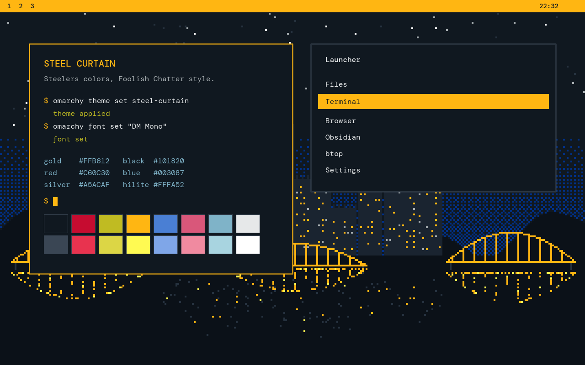

# Steel Curtain for Omarchy

An [Omarchy](https://omarchy.org/) theme by Alan Smodic. It pairs the Pittsburgh Steelers palette with the design system from [Foolish Chatter](https://foolishchatter.com/): Steelers Black backgrounds, Steelers Gold accents, square 2px borders, and the hard black-on-yellow inversion from the site, so the selected row in the launcher and menus turns solid gold with black text. Silver carries secondary text, and the terminal palette borrows Foolish Chatter's highlighter yellow and olive for bright yellow and green. [Pittsburgh Steelers color codes](https://teamcolorcodes.com/pittsburgh-steelers-color-codes/)

## Install

Run `omarchy theme install https://github.com/alansmodic/omarchy-steel-curtain-theme`, then pick **Steel Curtain** from the theme menu or run `omarchy theme set steel-curtain`. Omarchy generates the terminal, editor, and Hyprland configs from `colors.toml`, so everything follows the theme without extra steps.

## Font

The theme looks best with [DM Mono](https://github.com/googlefonts/dm-mono), the same typeface Foolish Chatter uses. Omarchy sets fonts system-wide rather than per theme, so install it separately. Download the static TTF files from the [Google Fonts repository](https://github.com/google/fonts/tree/main/ofl/dmmono) into `~/.local/share/fonts/DMMono/`, run `fc-cache -f`, then run `omarchy font set "DM Mono"`. DM Mono has no Nerd Font icons, so Omarchy falls back to JetBrainsMono Nerd Font for those. DM Mono runs narrow and tops out at Medium weight, so a terminal font size of 10 reads better than Omarchy's default of 8. To go back, run `omarchy font set "JetBrainsMono Nerd Font"`.

## Wallpapers

The four pixel-art backgrounds are Pittsburgh at night with its gold bridges, a gold dither, the Foolish Chatter highlighter yellow, and solid Steelers Black. Cycle through them with `omarchy theme bg next` or pick one with `omarchy background`. To add your own, drop images into `~/.config/omarchy/backgrounds/steel-curtain/`.

## What's in the theme

`colors.toml` holds the palette and window border colors, and Omarchy builds most app configs from it. `shell.toml` styles the bar, launcher, menus, popups, and notifications. `icons.theme` selects Yaru yellow dark icons.

References: [Foolish Chatter](https://foolishchatter.com/), [Foolish Chatter for Obsidian](https://github.com/alansmodic/foolish-chatter-obsidian), [DM Mono](https://github.com/googlefonts/dm-mono), [Omarchy themes](https://omarchy.org/themes/).
